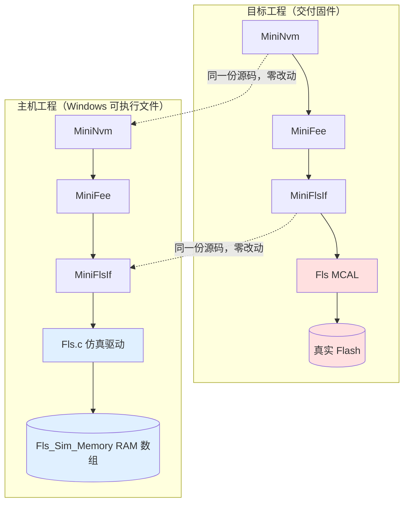

# 嵌入式代码 Windows 主机仿真测试实现指南

| 项目 | 内容 |
| --- | --- |
| 文档名称 | 嵌入式代码 Windows 主机仿真测试实现指南 |
| 适用对象 | 需要在 PC 上完成**编译、运行、单步调试、自动化回归**的嵌入式 C 模块：AUTOSAR BSW 上层模块、MCAL 之上的驱动、异步状态机、存储栈等 |
| 参考实现 | MiniAutosar 主机验证环境（`Codes/Port/`、`Codes/Test/MiniNvm_Test.c`、`CMakeLists.txt`、`.vscode/`） |
| 设计版本 | V1.1 |
| 作者 | Manco |
| 目标 | 给出一套可复用的“主机同步仿真”落地方案：**识别平台耦合点 → 构建主机适配层 → 介质仿真 → 自检用例 → CMake/CTest 自动化 → gdb 调试**，使新项目能照此复制 |

---

## 1. 要解决的问题

嵌入式模块天生跑不起来在 PC 上，原因可以拆成四类，本方案逐类给出对策：

| 障碍 | 典型现象 | 后果 | 本方案对策 |
| --- | --- | --- | --- |
| 依赖平台头文件 | 找不到 `Platform_Types.h` / `MemIf_Types.h` / MCAL 头 | 无法编译 | 在主机适配层提供**同名的最小类型桩** |
| 依赖硬件驱动 | 直接调用 `Fls_Write` / 寄存器读写 | 无法链接 | 用**RAM 介质仿真驱动**替换该层，接口原型保持完全一致 |
| 上层是异步状态机 | `E_OK` 只表示“已接受”，必须轮询 `MainFunction` | 同步假实现会漏测关键分支 | 仿真**保留异步语义**，由测试代码手工轮询驱动 |
| 硬件行为不可复现 | Flash 只能 1→0、擦除按扇区对齐、掉电中断 | 物理约束类 bug 到量产才暴露 | 在仿真里**显式建模物理约束**并计数 |

### 1.1 第一铁律：适配层只新增，不修改目标源码

主机工程与目标工程**共用同一份业务源码**（如 `Codes/Memory/**`），主机适配层是**纯新增**的旁路文件。

```text
Codes/Memory/**    <- 被测目标源码，主机与目标工程共用，零改动、零 #ifdef
Codes/Port/**      <- 主机适配层，纯新增，不参与目标工程交付
Codes/Test/**      <- 自检用例，同样可被目标工程复用（量产需摘除调用）
```

这条铁律的价值在于：**仿真验证过的代码就是交付的代码**。一旦引入 `#ifdef HOST_TEST` 分支，验证结果就与交付物脱钩，方案的核心价值随之失效。

---

## 2. 核心原理：找到那条“缝”

整套方案成立的关键，是代码栈里存在一个**唯一的平台耦合点**。集成手册里应明确写出这句话（本工程即：“MiniFlsIf 是唯一需要改动的移植点”）。

### 2.1 判定“缝”的三条判据

| 判据 | 说明 | 本工程实例 |
| --- | --- | --- |
| 接口是**标准/稳定原型** | 有公开规范定义，替身实现不会因上层演进失效 | `Fls_Init/Read/Write/Erase/GetStatus/GetJobResult/MainFunction` 与 MCAL Fls 一致 |
| 上层**只依赖该头文件** | 无散落的寄存器访问、无隐含硬件假设 | `MiniFlsIf.c` 只 `#include "Fls.h"`，转发调用 |
| 接口**数量少、职责窄** | 替身实现工作量可控（十几个函数以内） | 7 个函数，全部异步语义可枚举 |

### 2.2 如果不唯一怎么办

若排查发现上层**多处**直接摸硬件（散落寄存器、直接操作外设），则**不要**逐个打桩，而应先做一次**架构重构**：把这些访问收敛进一个 HAL 接口层，之后再按本方案打桩。否则仿真层会退化成一堆难以维护的特例。

> 判断方法：把目标模块的 `#include` 清单全部列出，按“标准头 / 平台头 / 模块头”三分类。凡是平台头对应的符号即耦合点；如果同一个平台头被 5 个文件以 5 种方式使用，就该先重构。

### 2.3 替换关系示意



---

## 3. 目录与职责约定

新项目照此建目录（名字可换，职责切分不变）：

| 目录 / 文件 | 角色 | 关键约束 |
| --- | --- | --- |
| 目标源码区（如 `Codes/Memory/**`） | 被测对象 | 主机工程与目标工程**共用**，禁止出现主机专用分支 |
| 自检用例区（如 `Codes/Test/**`） | 测试用例集 | 提供单一入口函数（如 `MiniNvm_Test()`），返回 `E_OK/E_NOT_OK` |
| 主机适配层（如 `Codes/Port/**`） | 类型桩 + 介质仿真 + 入口 | **纯新增**；每个文件头注释必须写明“仅用于 PC 侧验证，不参与目标工程交付” |
| 调试/观测接口（如 `Fls_Sim.h`） | 非 AUTOSAR 的辅助接口 | 独立成文件，与 MCAL 同名头文件**分开放置**，避免污染 |
| 构建区（`CMakeLists.txt` / `CMakePresets.json`） | 主机验证构建工程 | 只把上述文件编进 `*_host` 目标 |
| 工具链脚本（`tools/setup-toolchain.ps1`） | 一键装工具链 | 幂等、免管理员、只改用户环境变量 |

### 3.1 主机适配层的完整构成（对照清单）

| 文件 | 作用 | 备注 |
| --- | --- | --- |
| `Platform_Types.h` | `uint8/uint16/uint32/boolean/float32...` 最小定义 | 语义与 AUTOSAR 一致，勿带入目标工程 |
| `Std_Types.h` | `Std_ReturnType`、`E_OK` / `E_NOT_OK`、`NULL_PTR`、`STD_HIGH/LOW` | 用 `#ifndef` 保护，允许被真实头覆盖 |
| `MemIf_Types.h` | `MemIf_StatusType` / `MemIf_JobResultType` 枚举 | **枚举取值必须与 AUTOSAR 一致**，否则上层状态判断会静默走错分支 |
| `MemM.h`、`SchM_Fls.h` 等 | 占位头（空实现/空声明） | 目的只是让目标源码“原样包含”即可编译 |
| `Common.h` / `Common.c` | 集成方提供的公共服务（如 `CommF_DataSet` / `CommF_DataCopy`） | PC 版语义必须与目标实现一致 |
| `<Device>.h` / `<Device>.c` | 介质/外设仿真驱动 | 接口原型与 MCAL 完全一致 |
| `<Device>_Sim.h` | 仿真专属观测接口：介质数组、dump、违规计数器 | 非 AUTOSAR 接口 |
| `main.c` | 控制台入口：调用自检、打印报告、返回退出码 | 退出码即 CI 判定依据 |

---

## 4. 实施步骤

### 步骤 1 — 盘点依赖，圈定耦合点

- **做法**：列出目标模块全部 `#include`，按“标准头 / 平台头 / 模块头”分类；画出调用链，标出唯一触碰硬件的一层。
- **产物**：耦合点清单（接口名 + 原型 + 语义说明）。
- **验收**：能用一句话说清“替换哪一层即可让整个栈离开硬件”。

### 步骤 2 — 建类型桩，先让它能编译

- **做法**：按步骤 1 的平台头清单逐个建立最小替代头；语义不明确的一律“占位但语义正确”（如 `SchM_Fls.h` 空实现，因为单核主机无临界区需求）；为每个桩文件写清“主机替代实现”的文件头注释。
- **产物**：`Codes/Port/Platform_Types.h`、`Std_Types.h`、`MemIf_Types.h`、`MemM.h`、`SchM_Fls.h` 等。
- **验收**：目标模块在 PC 上**能编译通过**（可暂不运行）。

### 步骤 3 — 写介质仿真驱动（工作量最大、价值最高）

- **做法**：见第 5 节设计要点。
- **产物**：`<Device>.c/.h` + `<Device>_Sim.h`。
- **验收**：接口原型与 MCAL 一致；异步语义完整；物理约束可触发；违规可计数。

### 步骤 4 — 写自检用例集

- **做法**：见第 6 节设计要点。
- **产物**：`Codes/Test/<Module>_Test.c/.h`。
- **验收**：单一入口函数返回 `E_OK/E_NOT_OK`，失败可定位到“用例-步骤-偏移-期望-实际”。

### 步骤 5 — 写控制台入口

- **做法**：`main.c` 调用自检入口 → 打印结构化报告 → 以退出码表达结论（`0` 通过 / `1` 失败）；提供 `--dump` 之类只影响观测、不影响判定结果的 CLI 选项。
- **产物**：`Codes/Port/main.c`。
- **验收**：`echo $LASTEXITCODE`（或 `%ERRORLEVEL%`）能直接反映通过/失败。

### 步骤 6 — 接构建与自动化

- **做法**：见第 7 节。
- **产物**：`CMakeLists.txt`、`CMakePresets.json`、`.vscode/{tasks,launch,extensions,c_cpp_properties}.json`、`tools/setup-toolchain.ps1`。
- **验收**：三条命令完成“配置 → 构建 → 回归”，且 `ctest` 失败时能给出可读报告。

---

## 5. 介质仿真驱动的设计要点

这是方案的**技术核心**。一份好的仿真驱动必须在“足够像真”和“足够简单”之间取平衡。

### 5.1 接口保真

| 要求 | 说明 | 反面案例 |
| --- | --- | --- |
| 原型完全一致 | 函数名、参数类型、返回类型、`const` 修饰与 MCAL 一致 | 把 `Fls_Write(uint32, const uint8*, uint32)` 写成 `Fls_Write(uint8*, uint32)` |
| 语义完全一致 | `E_OK` 只表示“请求已接受”，不代表“已完成” | 同步完成并返回结果，上层 `PENDING` 分支永不执行 |
| 状态机完全一致 | `MEMIF_UNINIT / IDLE / BUSY` 的迁移时机一致 | 未初始化也返回 `IDLE`，掩盖上电顺序 bug |
| 配置入口一致 | 保留 `Fls_Init(ConfigPtr)` + `FlsConfigSet` 的指针式调用约定 | 改成无参 `Fls_Init()`，迫使上层改动 |

### 5.2 异步保真（最容易被做错的一点）

**错误做法**：`Fls_Write()` 里直接写 RAM 并返回 `E_OK`，`Fls_GetStatus()` 恒返回 `MEMIF_IDLE`。
**后果**：上层状态机的 Busy 轮询、Job Pending 判定、超时与取消（`CancelJobs`）路径全部成为死代码，测了等于没测。

**正确做法**：请求只登记作业并置 `MEMIF_BUSY`，把真正的执行推迟到 `MainFunction()`：

```c
/* 受理：只登记，不执行 */
g_flsOp       = op;
g_flsOpOffset = offset;
g_flsOpLength = length;
g_flsRemain   = FLS_SIM_LATENCY_CYCLES;   /* 可配延迟，模拟异步时延，最小 1 */
g_flsStatus   = MEMIF_BUSY;
g_flsJobResult = MEMIF_JOB_PENDING;
return TRUE;

/* 推进：到达延迟后执行并落回 IDLE */
void Fls_MainFunction(void)
{
    if ((g_flsStatus != MEMIF_BUSY) || (g_flsOp == FLS_SIM_OP_NONE)) { return; }
    if (g_flsRemain > 0u)
    {
        g_flsRemain--;
        if (g_flsRemain > 0u) { return; }     /* 还没到点，继续 BUSY */
    }
    Fls_Sim_Execute();                        /* 真正搬数据 / 擦除 / 编程 */
    g_flsOp     = FLS_SIM_OP_NONE;
    g_flsStatus = MEMIF_IDLE;
}
```

把 `LATENCY_CYCLES` 做成宏并允许调大（比如 3~5），可以顺便压测上层的轮询逻辑是否写得足够健壮。

### 5.3 物理约束建模（仿真的“含金量”所在）

只把 Flash 当日志数组的仿真，抓不到真实硬件才会暴露的缺陷。逐条建模如下：

| 约束 | 真机行为 | 仿真实现 | 违反后果 |
| --- | --- | --- | --- |
| 擦除后状态 | 全 `0xFF` | `CommF_DataSet(..., 0xFFu, len)` | — |
| 编程方向 | 只能 `1 → 0`，不能把 0 位改回 1 | 逐字节校验 `(old & new) == new`，先全量校验**再**落数据 | 计 `ProgramViolations`，作业 `MEMIF_JOB_FAILED` |
| 擦除粒度 | 按扇区对齐 | `offset % SectorSize`、`length % SectorSize` 均须为 0 | 拒绝请求并计数 |
| 写粒度 | 按页对齐 | 参考实现仅保留 `PageSize` 配置项，未强制校验；如需覆盖非对齐写失败分支可自行补充 | — |
| 越界访问 | 总线错误 / 静默截断 | 检查 `[offset, offset+length)` 落在介质范围内 | 计 `OutOfRange`，作业失败 |
| 未初始化访问 | 未定义行为 | 校验 `g_flsInitialized` | 计 `RejectedRequests`，请求被拒 |
| 忙时重入 | 拒绝或排队 | 校验 `MEMIF_BUSY` | 计 `RejectedRequests`，请求被拒 |
| 零长度请求 | 未定义 | 直接拒绝 | 计 `RejectedRequests` |

**关键实现细节**：编程校验必须**先全量检查再写入**，否则会出现“写了一半才发现违规”的部分写入状态，与真机行为不符，还会把测试引向错误结论。

### 5.4 可观测性

仿真最大的优势是“随便看”，必须主动留出观测口：

1. **介质数组可 Watch**：`Fls_Sim_Memory[]` 为全局数组，调试时直接在 Watch 窗口按地址查看，无需任何工具；
2. **违规计数器**：把 `ProgramViolations` / `OutOfRange` / `RejectedRequests` 作为**断言依据**——正常业务回归结束后它们应全部为 0，非 0 即说明上层产生了非法访问序列；
3. **dump 接口**：`Fls_Sim_Dump(offset, length)` 按行打印十六进制镜像，配合 CLI 开关（`--dump`）在需要时输出，注意 dump 越界时只提示、不崩溃；
4. **复位接口**：`Fls_Sim_Reset()` 恢复全 `0xFF` 并清零计数，供用例之间构造干净起点。

### 5.5 上电 / 复位语义（别忽略）

```c
/* 仅首次上电复位仿真介质；重复 Init 视为复位/掉电重启，保留介质内容以验证冷启动路径。 */
if (g_flsInitialized == FALSE)
{
    Fls_Sim_Reset();
    g_flsInitialized = TRUE;
}
```

“首次 Init 复位、重复 Init 保留内容”的差别，正好对应**首次上电**与**掉电重启**两种场景。若每次 `Init` 都清空介质，掉电恢复、数据持久性这类核心用例就失去了验证基础。

### 5.6 几何一致性（最容易埋雷的地方）

仿真驱动里的介质几何常量（基址、总大小、扇区、页）必须与上层配置（如 `MiniFee_Cfg.c` 的簇表）严格对应：

- 参考实现：`基址 0xFF200000`、`总大小 0x4000`、`扇区 0x2000`，正好覆盖两个 `0x2000` 的簇；
- **双向标注**：仿真头里注释“修改上层簇表须同步此处”，上层配置里注释“须与仿真几何一致”；
- **可扩展做法**：把几何常量集中到一个宏块，或干脆从上层配置头推导，减少手工同步点；
- 注意“前 N 个簇必须落在仿真范围内”，否则迁移用例会直接撞越界。

### 5.7 骨架代码

```c
/* ===================== 仿真专属观测接口（<Device>_Sim.h） ===================== */
extern uint8  Fls_Sim_Memory[];            /**< 仿真介质后备 RAM，按偏移访问 */
extern const uint32 Fls_Sim_Size;          /**< 仿真介质总大小（字节） */
extern uint32 Fls_Sim_ProgramViolations;   /**< 二次编程违规计数 */
extern uint32 Fls_Sim_OutOfRange;          /**< 越界访问计数 */
extern uint32 Fls_Sim_RejectedRequests;    /**< 被拒绝请求计数 */
extern void Fls_Sim_Reset(void);
extern void Fls_Sim_Dump(uint32 offset, uint32 length);

/* ===================== 驱动内部：公共受理与执行 ===================== */
static boolean Fls_Sim_Accept(Fls_SimOpType op, uint32 offset, uint32 length)
{
    if ((g_flsInitialized == FALSE) || (g_flsStatus == MEMIF_BUSY))
    {
        Fls_Sim_RejectedRequests++;
        return FALSE;
    }
    if (length == 0u) { Fls_Sim_RejectedRequests++; return FALSE; }
    if (Fls_Sim_RangeOk(offset, length) == FALSE) { Fls_Sim_OutOfRange++; return FALSE; }
    if ((op == FLS_SIM_OP_ERASE) &&
        (((offset % FLS_SIM_SECTOR_SIZE) != 0u) || ((length % FLS_SIM_SECTOR_SIZE) != 0u)))
    {
        Fls_Sim_RejectedRequests++;
        return FALSE;
    }
    /* ... 登记作业、置 BUSY、设置延迟 ... */
    return TRUE;
}
```

---

## 6. 自检用例集的设计要点

### 6.1 必须自己驱动异步链路

主机构建里没有 OS、没有调度器，**测试代码必须扮演调度器的角色**，按与目标工程一致的顺序轮询各级 `MainFunction`：

```c
static MiniNvm_RequestResultType MiniNvm_Test_DriveBlock(uint8 blockId)
{
    uint32 guard = MININVM_TEST_POLL_GUARD;      /* 上限，见 6.2 */
    MiniNvm_RequestResultType result = MININVM_REQ_PENDING;

    while (result == MININVM_REQ_PENDING)
    {
        MiniFlsIf_MainFunction();                /* 自下而上，与目标调度顺序一致 */
        MiniFee_MainFunction();
        MiniNvm_MainFunction();
        if (guard-- == 0u)
        {
            (void)MiniNvm_CancelJobs();          /* 超时先取消，避免残留作业污染后续用例 */
            return MININVM_REQ_NOT_OK;
        }
        if (MiniNvm_GetErrorStatus(blockId, &result) != E_OK) { return MININVM_REQ_NOT_OK; }
    }
    return result;
}
```

要点：**轮询顺序必须自下而上**（底层在前）。顺序反了，高层会永远看到“底层还没完成”，用例会以超时告终。

### 6.2 每个轮询循环都要有 guard

`MININVM_TEST_POLL_GUARD` 是一道硬上限（参考值 `2000000`）。没有它，一个状态机卡死就会让 CI **无限挂起**，而不是干脆地失败。超时时记得顺手 `CancelJobs`，否则残留作业会污染后续用例。

### 6.3 用例分层（建议覆盖清单）

| 层次 | 用例 | 验证目标 |
| --- | --- | --- |
| 初始化前 | `PARAM` | 未初始化时请求必须被拒（先 `DeInit` 保证不依赖外部状态） |
| 空白介质 | `BLANK` | 无记录时读取返回默认值而非错误 |
| 基本功能 | `BASIC` | 单块写入→读回→逐字节比对 |
| 数据快照 | `SOURCE_COPY` | 入队时快照源数据，调用方后续改缓冲不影响落盘内容 |
| 批量路径 | `ALL` | 多块一次性读写走独立快路径，行为与逐块一致 |
| 异常路径 | `CANCEL` | 作业取消后状态、结果、队列都回到可用状态 |
| 压力路径 | `ROTATE` | 反复写满 → 触发簇迁移/翻页 → 数据不丢、结构正确 |

用例前先做一次全量擦除（`EraseAll`），构造确定的空白起点；直接调用底层接口擦除时，偏移要用 `簇起始地址 − 基址` 换算。

### 6.4 结果结构：失败必须可定位

一个只在末尾打印 `PASS/FAIL` 的测试，在 CI 上等于没有信息量。推荐结构：

```c
typedef struct
{
    uint8  OverallResult;    /* 汇总结论 E_OK / E_NOT_OK */
    uint8  CurCase;          /* 当前执行到的用例 */
    uint8  FailCaseId;       /* 首个失败用例 */
    uint8  FailStep;         /* 失败步骤编号 */
    uint32 FailOffset;       /* 失败字节偏移 */
    uint8  ExpectByte;       /* 期望值 */
    uint8  ActualByte;       /* 实际值 */
    uint32 PassCount;        /* 通过数 */
    uint32 FailCount;        /* 失败数 */
} Xxx_TestResultType;
```

入口函数返回 `E_OK/E_NOT_OK`，同时把细节写进全局结果结构，由 `main.c` 统一打印。这样 CI 日志里能直接看到“**哪个用例、第几步、哪个偏移、期望 vs 实际**”。

另外两点约定：

- **失败即记录、继续执行**：用 `Record(结果)` 汇总各用例，而不是第一个失败就 return，一次运行能拿到尽可能多的信息（初始化类前置失败除外）；
- **反馈闭环**：`FailOffset` + `ExpectByte` + `ActualByte` 三件套配合第 5.4 节的 dump，可以在不接调试器的情况下定位大多数问题。

### 6.5 白盒校验：越过 API 看介质

除了走 API 的“黑盒”校验，还应保留一部分**直接读介质原始字节**的白盒校验。参考实现里 `ROTATE` 用例通过底层读回簇头原始字节，再本地重算 CRC-8 比对，验证迁移后结构真的写对了——这种用例能在“接口返回全 OK 但数据错了”的情形下把问题揪出来。

### 6.6 用例强度按环境注入，不改源码

不同构建环境需要不同的测试强度（例如压力用例的轮数）。做法是**源码给默认值 + 构建系统覆盖**：

```c
#ifndef MININVM_TEST_ROT_ROUNDS
#define MININVM_TEST_ROT_ROUNDS   (8u)      /* 目标工程默认：小，省时间 */
#endif
```

```cmake
set(MINIAUTOSAR_TEST_ROT_ROUNDS "240" CACHE STRING
    "Rotation rounds used by the host self-test (>=113 triggers a migration)")
target_compile_definitions(miniautosar_host PRIVATE
    MININVM_TEST_ROT_ROUNDS=${MINIAUTOSAR_TEST_ROT_ROUNDS}u)
```

主机侧把默认 8 覆盖为 240，压力路径才真正被走到；而**目标工程的默认值保持不动**。注意给宏的参数留出库内合法范围（此处受 `uint8` 计数器限制，须 `≤ 255`）。

### 6.7 破坏性声明必须双向传递

自检会擦写数据区，**量产固件必须摘除调用**。这一条要同时出现在：自检头文件的 `@note`、README、集成手册的移植检查清单。只在代码里注释一句是不够的。

---

## 7. 构建与自动化

### 7.1 CMake 组织方式

按“角色”而不是“目录”组织源文件列表，让被替换的层一目了然：

```cmake
cmake_minimum_required(VERSION 3.20)
project(MiniAutosar VERSION 1.1.0 LANGUAGES C)

set(CMAKE_C_STANDARD 99)
set(CMAKE_C_STANDARD_REQUIRED ON)
set(CMAKE_C_EXTENSIONS OFF)              # 关掉 GNU 扩展，逼近嵌入式编译器行为
set(CMAKE_EXPORT_COMPILE_COMMANDS ON)    # 生成 compile_commands.json，供 IDE/clangd

# 目标源码（零改动）
set(MEMORY_SOURCES  ${CMAKE_CURRENT_SOURCE_DIR}/Codes/Memory/MiniFlsIf/MiniFlsIf.c ...)
set(CONFIG_SOURCES  ${CMAKE_CURRENT_SOURCE_DIR}/Codes/Config/MiniFee_Cfg.c ...)
set(TEST_SOURCES    ${CMAKE_CURRENT_SOURCE_DIR}/Codes/Test/MiniNvm_Test.c)
# 主机专属：类型桩 + 介质仿真 + 入口
set(PORT_SOURCES    ${CMAKE_CURRENT_SOURCE_DIR}/Codes/Port/Common.c
                    ${CMAKE_CURRENT_SOURCE_DIR}/Codes/Port/Fls.c
                    ${CMAKE_CURRENT_SOURCE_DIR}/Codes/Port/main.c)

add_executable(miniautosar_host ${MEMORY_SOURCES} ${CONFIG_SOURCES} ${TEST_SOURCES} ${PORT_SOURCES})
target_include_directories(miniautosar_host PRIVATE
    ${CMAKE_CURRENT_SOURCE_DIR}/Codes/Port          # 主机替换头必须排在最前
    ${CMAKE_CURRENT_SOURCE_DIR}/Codes/Config ...)

if(MSVC)
    target_compile_options(miniautosar_host PRIVATE /W4 /WX- /permissive-)
else()
    target_compile_options(miniautosar_host PRIVATE -Wall -Wextra -Wno-unused-parameter -fno-omit-frame-pointer)
    if(CMAKE_BUILD_TYPE STREQUAL "Debug")
        target_compile_options(miniautosar_host PRIVATE -g3 -O0)   # 可单步调试
    endif()
endif()

enable_testing()
add_test(NAME miniautosar_selftest COMMAND miniautosar_host)
```

要点：

- **包含目录顺序**：主机替换头目录放最前，确保 `#include "Fls.h"` 命中的是仿真版而非 MCAL 版；
- **多编译器兼容**：MSVC / GCC 两套告警开关，便于团队各取所需；
- **`CMAKE_C_EXTENSIONS OFF`**：禁止 GNU 扩展，让主机编译更接近嵌入式编译器的严格程度，提前暴露可移植性问题；
- **命名统一**：主机目标统一带 `_host` 后缀，避免与目标工程产物混淆。

### 7.2 CMake Presets：免手写参数

```json
{
  "configurePresets": [
    { "name": "windows-mingw-debug",   "generator": "Ninja",
      "binaryDir": "${sourceDir}/build",
      "cacheVariables": { "CMAKE_BUILD_TYPE": "Debug", "CMAKE_C_COMPILER": "gcc",
                          "MINIAUTOSAR_TEST_ROT_ROUNDS": "240" } },
    { "name": "windows-mingw-release", "generator": "Ninja",
      "binaryDir": "${sourceDir}/build-release",
      "cacheVariables": { "CMAKE_BUILD_TYPE": "Release", "CMAKE_C_COMPILER": "gcc" } }
  ],
  "testPresets": [
    { "name": "windows-mingw-debug", "configurePreset": "windows-mingw-debug",
      "output": { "outputOnFailure": true } }
  ]
}
```

Debug / Release 使用**不同 binaryDir**，避免互相踩缓存；`outputOnFailure: true` 让 CI 里失败的用例输出完整报告。

### 7.3 CTest：退出码即结论

```powershell
cmake --preset windows-mingw-debug
cmake --build --preset windows-mingw-debug
ctest  --preset windows-mingw-debug --output-on-failure
```

`main()` 返回 `0`（全部通过）/ `1`（存在失败用例），CTest 依此判定，无需解析日志。直接运行可执行文件时也是同一套约定，方便本地快速验证：

```powershell
.\build\miniautosar_host.exe            # 运行自检，退出码 0 表示全部通过
.\build\miniautosar_host.exe --dump     # 额外 dump 仿真介质镜像（只影响输出，不影响判定）
```

### 7.4 工具链脚本的设计要点

`tools/setup-toolchain.ps1` 的目标是让新同事**一条命令进入可构建状态**：

| 设计点 | 做法 |
| --- | --- |
| 免管理员 | 装到 `%LOCALAPPDATA%\<Project>Tools`，只改**用户** PATH，不写系统目录、不注册卸载项 |
| 幂等 | 已安装的组件跳过，除非显式 `-Force` |
| 网络韧性 | 多镜像回退（`gh-proxy.com` → `ghfast.top` → 直连），`curl --fail --retry 3` |
| 版本可追溯 | 版本号与文件名提为脚本顶部变量，便于统一升级 |
| 明确提示 | 结束时提示“重启终端 / VS Code 使 PATH 生效” |

> 注意：脚本写入 PATH 后，**当前终端不会立即生效**，构建前需重开终端或在脚本中显式拼接 `$env:PATH`。

### 7.5 VS Code 集成

| 文件 | 作用 |
| --- | --- |
| `.vscode/extensions.json` | 推荐 `ms-vscode.cpptools` + `ms-vscode.cmake-tools`，新环境自动提示安装 |
| `.vscode/tasks.json` | configure / build / clean / ctest / run / run-dump 等任务 |
| `.vscode/launch.json` | gdb 调试配置，`preLaunchTask` 先构建，`miDebuggerPath` 指向便携 gdb |
| `.vscode/c_cpp_properties.json` | IntelliSense 路径 + `compileCommands` 指向构建产物；`defines` 与 CMake 保持一致 |

---

## 8. 调试体验

主机仿真的最大回报是**调试体验**，新项目应把这几件事配齐：

1. **F5 一键调试**：`launch.json` 中 `preLaunchTask` 绑定构建任务，按 F5 即编译并停在 `main()`；
2. **断点下在状态机子状态上**：例如 `MiniFee_MainFunction` / `MiniNvm_MainFunction` / 簇迁移子状态机，配合调用栈能完整还原一次异步作业的生命周期；
3. **Watch 介质数组**：把 `Fls_Sim_Memory` 以十六进制数组形式加入 Watch，写入/擦除/迁移的过程肉眼可见；
4. **条件断点 + 计数器**：在 `Fls_Sim_Execute()` 的违规分支上打断点，可立刻定位是哪次上层写触发了二次编程违规；
5. **dump 与调试互补**：非交互场景（CI、脚本）用 `--dump`，交互场景用 Watch。

---

## 9. 移植检查清单（复制到新项目）

**架构**
- [ ] 已确认存在唯一的平台耦合层，且上层只依赖其头文件
- [ ] 耦合点不唯一时，先完成 HAL 抽取重构，再开始打桩
- [ ] 主机适配层为纯新增文件，目标源码零改动、零 `#ifdef HOST`
- [ ] 每个主机适配文件头注释标明“仅用于 PC 侧验证，不参与目标工程交付”

**类型桩**
- [ ] `Platform_Types.h` / `Std_Types.h` / `MemIf_Types.h` 齐备，枚举取值与 AUTOSAR 一致
- [ ] 纯占位头（`MemM.h` / `SchM_Fls.h` 等）能让目标源码原样包含并编译通过
- [ ] 集成交互函数（`CommF_*` 等）的 PC 实现语义与目标实现一致

**介质仿真**
- [ ] 接口原型、返回语义、状态机迁移与 MCAL 完全一致
- [ ] 异步语义保留：请求只登记，执行在 `MainFunction`，延迟周期可配
- [ ] 物理约束已建模：擦除 `0xFF`、只允许 `1→0`、擦除对齐、越界、未初始化、忙重入
- [ ] 编程校验“先全量检查再写入”，无部分写入中间态
- [ ] 违规计数器齐备，且能在回归结束时断言为 0
- [ ] 首次 Init 复位、重复 Init 保留内容（覆盖掉电重启语义）
- [ ] 仿真几何与上层配置一致，且两侧互相标注

**自检用例**
- [ ] 入口函数单一，返回 `E_OK/E_NOT_OK`，不存在多套入口
- [ ] 轮询顺序自下而上，与目标调度顺序一致
- [ ] 每个轮询循环都有 guard，超时能取消作业并返回失败
- [ ] 覆盖初始化前、空白、基本、快照、批量、异常、压力七类用例
- [ ] 失败结果可定位到用例 / 步骤 / 偏移 / 期望 / 实际
- [ ] 破坏性声明在头文件、README、集成手册三处均有提示

**构建与调试**
- [ ] `Codes/Port` 在包含目录中排最前，确保替换头优先命中
- [ ] Debug 构建带 `-g3 -O0`（或 MSVC 等价配置），可单步调试
- [ ] CTest 已注册，退出码语义明确
- [ ] 用例强度参数由构建系统注入，源码默认值面向目标工程
- [ ] `compile_commands.json` 已导出，IntelliSense 无红波浪线
- [ ] 工具链脚本幂等、免管理员、多镜像回退
- [ ] `launch.json` 的 `miDebuggerPath` 指向便携工具链路径

**边界认知（明确“测不到什么”）**
- [ ] 中断 / 并发 / 临界区路径（`SchM_*` 为空实现时）未覆盖，已在文档中声明
- [ ] 真实时序、外设寄存器、多核竞争、ECC、掉电瞬态未覆盖
- [ ] 仿真主频/时延与目标不一致，性能相关结论不可信

---

## 10. 常见陷阱

| 现象 | 根因 | 对策 |
| --- | --- | --- |
| 上层 `PENDING` 分支从未执行 | 仿真驱动同步返回结果 | 保留异步语义，请求只登记，`MainFunction` 推进 |
| 测试偶尔挂死，CI 无限等待 | 轮询无上限 | 每个循环加 guard，超时取消作业并失败 |
| 读回的枚举状态判断总是走同一分支 | 桩头里 `MemIf_*` 枚举取值与 AUTOSAR 不一致 | 枚举取值严格对照规范 |
| 改了上层簇表后出现诡异越界 | 仿真几何未同步 | 两侧互相标注；把几何集中为宏块 |
| 单元测试之间互相影响 | 介质残留上一用例数据 | 用例前 `EraseAll`，并提供 `Sim_Reset()` |
| 测试通过但真机数据错了 | 只做黑盒校验 | 增加直接读介质原始字节 + 重算 CRC 的白盒校验 |
| 每次 `Init` 都清空介质，掉电恢复测不了 | 复位时机放在了重复 Init | 仅首次 Init 复位 |
| CI 日志只有一行 `FAIL` | 结果结构只有布尔结论 | 记录用例/步骤/偏移/期望/实际 |
| 主机编译通过、目标编译失败 | 主机用了 GNU 扩展或宽泛类型 | `CMAKE_C_EXTENSIONS OFF`、严格告警、统一 AUTOSAR 类型 |
| 量产固件误含自检，擦掉数据区 | 破坏性声明只写在 .c 注释里 | 头文件 `@note` + README + 集成手册清单三处声明 |
| 新同事环境起不来 | 工具链靠人工口头传授 | 幂等安装脚本 + `extensions.json` 推荐 |

---

## 附录 A：新项目落地顺序（TL;DR）

```text
1. 画出调用链，圈出唯一触碰硬件的那一层          -> 产出：耦合点清单
2. 建 Port 类型桩，让目标源码在 PC 上编译通过      -> 产出：能编译
3. 写介质仿真驱动（异步 + 物理约束 + 计数器 + dump）-> 产出：能运行
4. 写自检用例（守卫轮询 + 分层用例 + 可定位结果）   -> 产出：能验证
5. 写 main 入口 + CMake + CTest + presets        -> 产出：能回归
6. 配 launch/tasks + 工具链脚本                   -> 产出：能调试、易上手
7. 把“测不到什么”写进文档，避免过度信任仿真结论    -> 产出：边界清晰
```

验收标准一句话：**新同事 clone 仓库后，一条命令装工具链、三条命令完成“构建 + 回归 + 定位失败”，全程不接硬件。**
